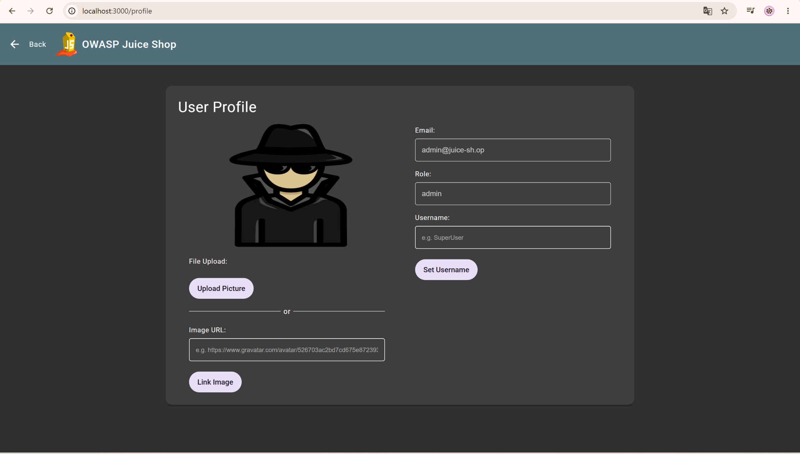
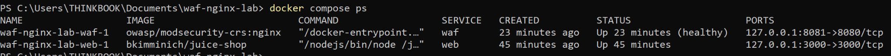
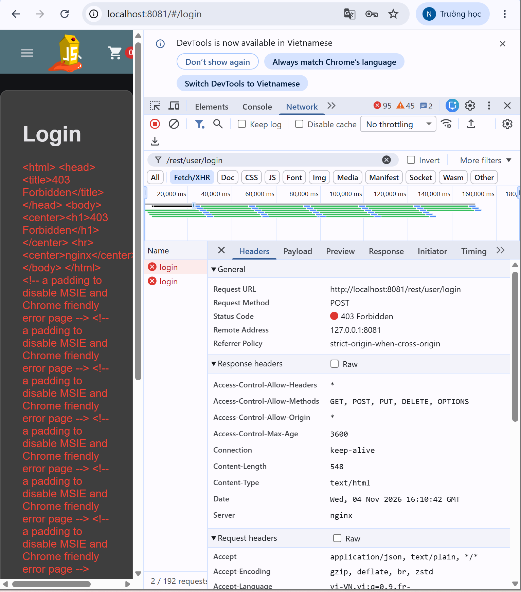
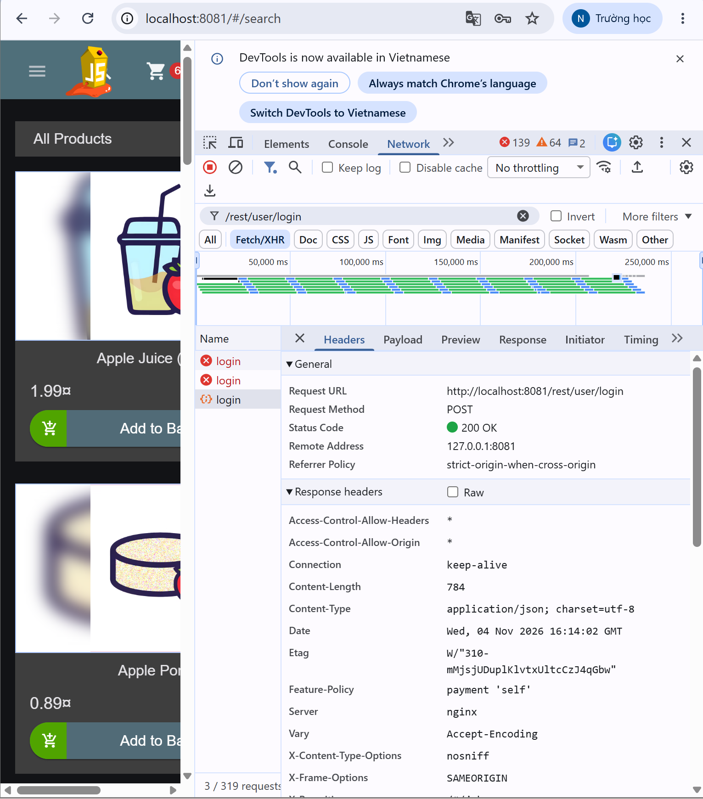
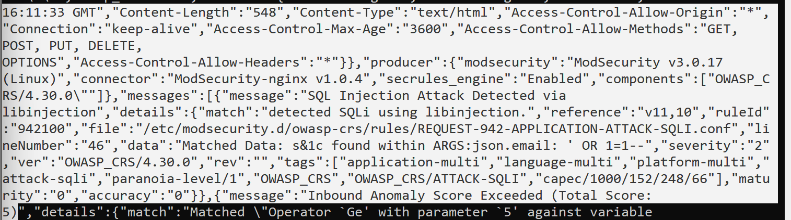

# Thực hành WAF trên Nginx

- Họ tên: Nguyễn Thuỳ Trang
- MSSV: 24021644
- Lớp: KTPM thứ 5 ca 1

## Mục tiêu

Triển khai Nginx kết hợp ModSecurity và OWASP CRS trước
OWASP Juice Shop; so sánh đăng nhập SQL injection khi
gọi trực tiếp và khi đi qua WAF.

## Mô hình

Hệ thống gồm hai service chạy bằng Docker Compose:

| Service | Image | Vai trò |
| --- | --- | --- |
| `web` | `bkimminich/juice-shop` | Ứng dụng web có lỗ hổng phục vụ thực hành |
| `waf` | `owasp/modsecurity-crs:nginx` | Nginx kết hợp ModSecurity và CRS để kiểm tra request |

Hai đường truy cập được sử dụng:

| Địa chỉ | Đường đi của request |
| --- | --- |
| `http://localhost:3000` | Trình duyệt → Juice Shop |
| `http://localhost:8081` | Trình duyệt → WAF → Juice Shop |

## Cấu hình

File `docker-compose.yml`:

```yaml
services:
  web:
    image: bkimminich/juice-shop
    ports:
      - "127.0.0.1:3000:3000"

  waf:
    image: owasp/modsecurity-crs:nginx
    ports:
      - "127.0.0.1:8081:8080"
    environment:
      BACKEND: "http://web:3000"
      MODSEC_RULE_ENGINE: "On"
      BLOCKING_PARANOIA: "1"
    depends_on:
      - web
```

Giải thích cấu hình:

| Cấu hình | Ý nghĩa |
| --- | --- |
| `BACKEND: "http://web:3000"` | Địa chỉ ứng dụng mà WAF chuyển tiếp request được cho phép |
| `MODSEC_RULE_ENGINE: "On"` | Bật ModSecurity ở chế độ phát hiện và chặn |
| `BLOCKING_PARANOIA: "1"` | Sử dụng mức paranoia 1 để chặn |
| `127.0.0.1:8081:8080` | Ánh xạ cổng 8081 trên máy tới cổng 8080 trong container WAF |
| `depends_on` | Khởi động service `web` trước service `waf`; không đảm bảo ứng dụng đã sẵn sàng |

Docker Compose tạo mạng nội bộ để WAF có thể gọi ứng dụng bằng tên service `web`.


## Các bước thử nghiệm

### SQL injection không qua WAF

Truy cập:

```text
http://localhost:3000/#/login
```

Nhập:

```text
Email: ' OR 1=1--
Password: abc123
```

Nhấn **Log in** và kiểm tra tài khoản sau đăng nhập.

**Kết quả:** đăng nhập thành công vào tài khoản `admin@juice-sh.op`, có vai trò `admin`.

### SQL injection qua WAF

Truy cập:

```text
http://localhost:8081/#/login
```

Nhập lại cùng payload và mật khẩu ở trường hợp trên.

Mở **Developer Tools → Network**, lọc `/rest/user/login` và kiểm tra request sau khi nhấn **Log in**.

**Kết quả:** request `POST /rest/user/login` trả HTTP `403 Forbidden`; đăng nhập bị chặn.

### Đăng nhập hợp lệ qua WAF

Truy cập trang đăng nhập qua cổng `8081`, nhập:

```text
Email: admin@juice-sh.op
Password: admin123
```

**Kết quả:** request `POST /rest/user/login` trả HTTP `200 OK`, đăng nhập thành công.

## Kết quả thực nghiệm

| Trường hợp | Đường truy cập | Kết quả thực tế |
| --- | --- | --- |
| SQL injection không qua WAF | Cổng `3000` | Đăng nhập thành công vào tài khoản admin |
| SQL injection qua WAF | Cổng `8081` | HTTP `403 Forbidden`, request bị chặn |
| Đăng nhập hợp lệ qua WAF | Cổng `8081` | HTTP `200 OK`, đăng nhập thành công |


## Bằng chứng

### Đăng nhập bằng SQL injection không qua WAF



### Các container đang chạy



### SQL injection bị chặn qua WAF



### Đăng nhập hợp lệ qua WAF



### Log phát hiện SQL injection



## Phân tích

Log của request bị chặn ghi nhận:

| Thông tin | Giá trị quan sát được |
| --- | --- |
| Phương thức | `POST` |
| Đường dẫn | `/rest/user/login` |
| Vị trí dữ liệu bị phát hiện | `ARGS:json.email` |
| Payload | `' OR 1=1--` |
| Thông báo | `SQL Injection Attack Detected via libinjection` |
| Tổng điểm bất thường | `5` |
| Ngưỡng chặn trong lần thử | `5` |
| Trạng thái ngắt request | `is_interrupted: true` |
| Mã HTTP trả về | `403` |

Quá trình xử lý trong lần thử:

1. WAF nhận request đăng nhập có dữ liệu JSON.
2. Phát hiện dấu hiệu SQL injection trong trường email bằng libinjection.
3. Tổng điểm bất thường của request đạt `5`.
4. Xác định điểm đạt ngưỡng chặn.
5. WAF chặn request và trả HTTP `403 Forbidden`.

## Nhận xét

Khi truy cập trực tiếp qua cổng `3000`, payload SQL injection cho phép đăng nhập vào tài khoản admin mà không cần mật khẩu đúng. Kết quả thể hiện lỗ hổng ở chức năng đăng nhập của ứng dụng thực hành.

Khi gửi cùng payload qua cổng `8081`, WAF phát hiện SQL injection và trả HTTP `403 Forbidden`. Log xác nhận phát hiện payload, sau đó thực hiện đánh giá chặn khi tổng điểm đạt ngưỡng.

Đăng nhập bằng thông tin hợp lệ qua WAF vẫn thành công với HTTP `200 OK`. Như vậy, trong các ca thử đã thực hiện, WAF chặn được payload tấn công và cho phép request đăng nhập hợp lệ.

WAF bổ sung một lớp bảo vệ nhưng không sửa lỗ hổng gốc của ứng dụng. Cổng `3000` được mở trong bài để đối chứng; khi triển khai thực tế cần kiểm soát đường truy cập trực tiếp để tránh bỏ qua WAF.

Kết quả chỉ phản ánh các ca thử trong bài, không chứng minh WAF có thể ngăn chặn mọi hình thức SQL injection.
